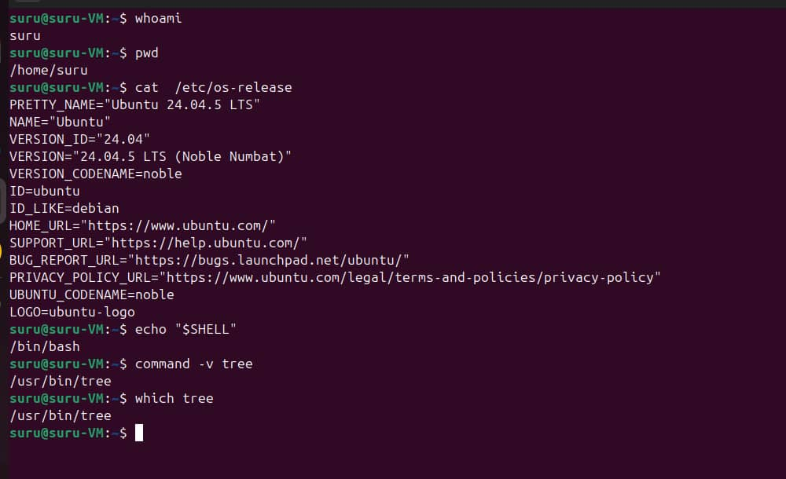
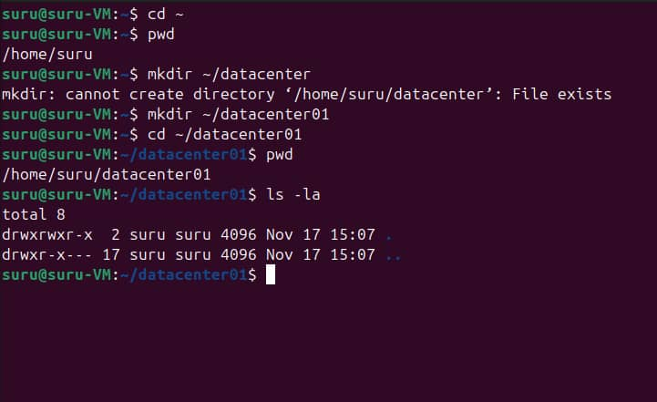
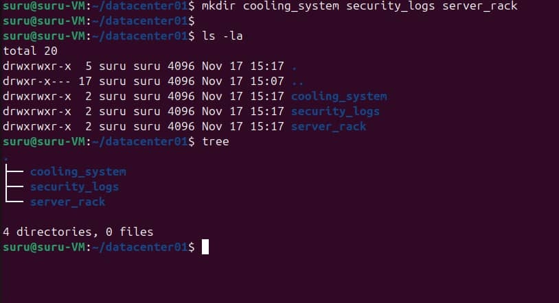
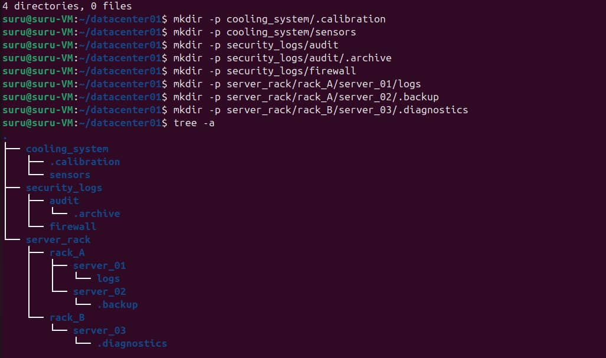
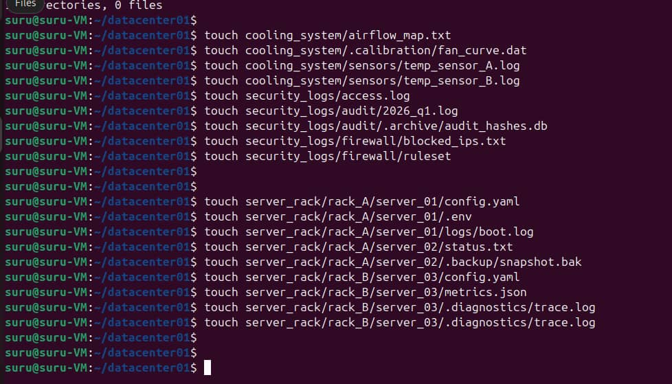
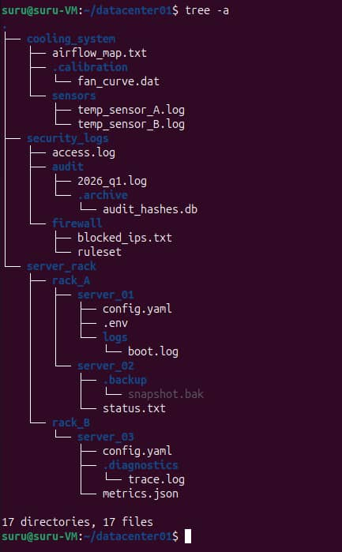

# Linux Data Center Filesystem Lab

I built a mock data center directory structure on an Ubuntu virtual machine. The lab models cooling-system records, security logs, and server-rack files. It demonstrates Linux command-line navigation, nested directory creation, hidden entries, and filesystem verification.

**Environment** · Ubuntu 24.04.5 LTS · Bash · `tree`

## 1. Verify the lab environment

```bash
whoami
pwd
cat /etc/os-release
echo "$SHELL"
command -v tree
```



## 2. Create the workspace

The VM already had a `~/datacenter` directory, so I used `~/datacenter01` for this run. Use a fresh workspace path if that directory already exists on your VM.

```bash
mkdir ~/datacenter01 && cd ~/datacenter01
pwd
ls -la
```



## 3. Build the directory hierarchy

```bash
mkdir cooling_system security_logs server_rack
tree
```



Use `mkdir -p` to create nested paths and their parent directories. The `-a` option lets `tree` display entries whose names begin with a dot.

```bash
mkdir -p \
  cooling_system/.calibration \
  cooling_system/sensors \
  security_logs/audit/.archive \
  security_logs/firewall \
  server_rack/rack_A/server_01/logs \
  server_rack/rack_A/server_02/.backup \
  server_rack/rack_B/server_03/.diagnostics
tree -a
```



## 4. Create placeholder files

These files represent operational records such as temperature readings, audit logs, configuration files, and diagnostics. On the fresh workspace, `touch` creates each file empty.

```bash
touch \
  cooling_system/airflow_map.txt \
  cooling_system/.calibration/fan_curve.dat \
  cooling_system/sensors/temp_sensor_A.log \
  cooling_system/sensors/temp_sensor_B.log \
  security_logs/access.log \
  security_logs/audit/2026_q1.log \
  security_logs/audit/.archive/audit_hashes.db \
  security_logs/firewall/blocked_ips.txt \
  security_logs/firewall/ruleset \
  server_rack/rack_A/server_01/config.yaml \
  server_rack/rack_A/server_01/.env \
  server_rack/rack_A/server_01/logs/boot.log \
  server_rack/rack_A/server_02/status.txt \
  server_rack/rack_A/server_02/.backup/snapshot.bak \
  server_rack/rack_B/server_03/config.yaml \
  server_rack/rack_B/server_03/metrics.json \
  server_rack/rack_B/server_03/.diagnostics/trace.log
```



## 5. Verify the result

```bash
tree -a
```

The completed lab contains **17 directories including the workspace root and 17 files**. The final screenshot shows hidden entries such as `.env`, `.archive`, and `.diagnostics`.


